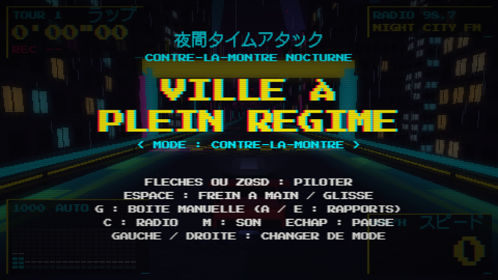
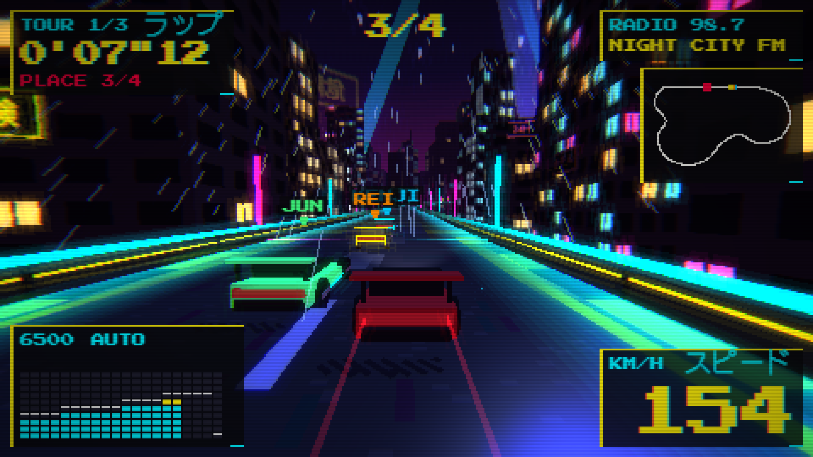
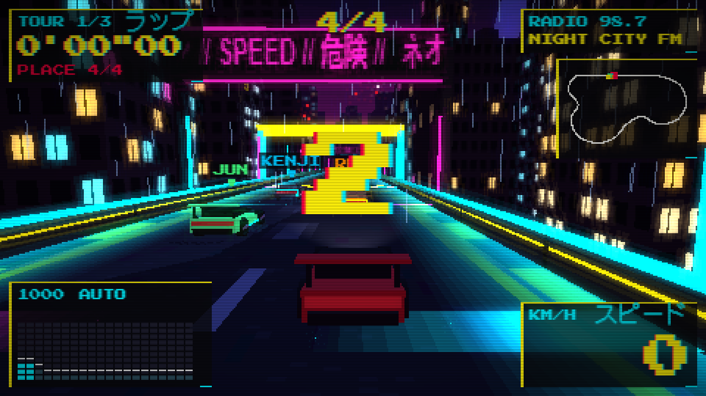
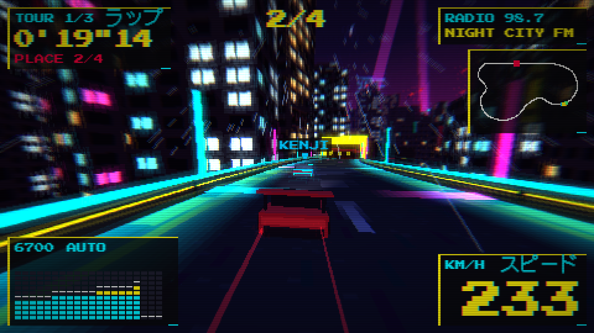
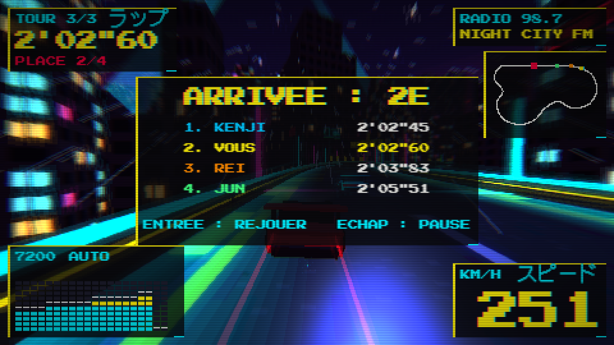

<p align="center"></p>

<h1 align="center">VILLE À PLEIN RÉGIME</h1>
<p align="center"><b>夜間タイムアタック</b> · <i>contre-la-montre nocturne</i></p>

<p align="center"></p>

<p align="center"><b>★ ★ ★ NOUVEAU ! ★ ★ ★</b><br>
<b>LA NUIT EST À VOUS. LA VILLE AUSSI.</b></p>

---

### 🌃 Minuit. Les néons s'allument. Le compte-tours grimpe.

Prenez le volant d'une bête de 500 chevaux et lâchez-la dans les artères d'une mégalopole cyberpunk qui ne dort jamais. Pluie, gratte-ciel, enseignes en katakana : chaque virage est une carte postale, chaque ligne droite une invitation à passer la sixième.

<p align="center"></p>

### 🏁 DEUX MODES DE JEU EXPLOSIFS !

- **CONTRE-LA-MONTRE** : enchaînez les tours, battez vos records… puis battez votre propre **fantôme** !
- **COURSE** : 3 tours, 3 rivaux sans pitié. **KENJI**, **REI** et **JUN** ne vous feront aucun cadeau.

<p align="center"></p>

### ⚙️ UNE MÉCANIQUE DE PRO

- Boîte **automatique ou manuelle** : passez vos rapports comme un vrai pilote !
- **Frein à main** et glisses contrôlées : prenez les épingles en travers !
- Physique inspirée d'une **vraie GT japonaise** : couple, rapports, aéro, tout y est !
- Frottez les murs… et regardez voler les **étincelles** !

<p align="center"></p>

### 📻 3 STATIONS DE RADIO EN DIRECT

La bande-son est **composée en temps réel** et **réagit à votre conduite**. Plus vous appuyez, plus elle s'emballe ! Branchez-vous sur **NIGHT CITY FM** ou zappez d'une touche.

<p align="center"></p>

### 💾 AUCUNE INSTALLATION !

Pas de disquette, pas de CD, pas de téléchargement de 40 Go. **Un navigateur, et c'est parti.**

| | |
|---|---|
| 🎮 Genre | Course arcade |
| 👤 Joueurs | 1 |
| 🖥️ Plateforme | Tout navigateur moderne |
| ⏱️ Chargement | Instantané |
| 💰 Prix | **GRATUIT** |

<p align="center"><b>DISPONIBLE DÈS MAINTENANT DANS TOUS LES BONS NAVIGATEURS.</b><br>
<sub>Le pilotage nocturne doit se pratiquer en toute sécurité, sur écran uniquement.</sub></p>

---

# Pour les développeurs

Jeu de course arcade solo, contre-la-montre en 3D pixelisée. Cinq cartes, chacune avec son tracé, sa voiture, sa radio, son décor et son interface ; la musique réagit à la course.

| Carte | Conduite | Voiture | Radio |
|---|---|---|---|
| Ville à plein régime | viaduc et échangeur de nuit, presque tout à fond | Nismo GT-R Z-tune | darksynth, house, breakbeat |
| Karasu-tōge | col de montagne : montée rapide, quatre épingles en descente | Mazda RX-7 Spirit R | eurobeat |
| Wan-9 | autoroute de baie à 270 km/h, boucle serrée, camions à doubler | Toyota Supra RZ | trance |
| Premier métro | rues de Paris à l'aube, relances entre des angles | Renault 5 Maxi Turbo | disco spatiale |
| Canal 6 | canal de Los Angeles au couchant, large et glissant | Dodge Viper GTS | g-funk |

Le menu principal choisit la carte, le mode et la boîte (haut / bas pour la ligne, gauche / droite pour la valeur, Entrée pour démarrer). Deux modes : **contre-la-montre** (tours lancés, record et fantôme par carte) et **course** (3 tours, départ en grille contre 3 IA, classement à l'arrivée). La ligne MODE du menu fait aussi défiler la difficulté de la course (détente, normal, chaud : `DIFF` dans `sim.js`). En contre-la-montre, chaque carte a ses médailles de temps, calculées sur le tour lancé du pilote automatique (`med` dans `cartes.js`). Changer de carte recharge la page ; on peut aussi la choisir par l'adresse : `?carte=touge`, `wangan`, `paris`, `canal`, `ville`.

Tout tourne dans le navigateur, sans étape de build ni dépendance à installer.

## Lancer

- **Le plus simple** : double-cliquer sur `index.html`.
- **Avec un serveur local** (recommandé pour développer) :

```bash
python -m http.server 8123
```

puis ouvrir http://localhost:8123/.

## Commandes

| Touche | Action |
|---|---|
| Haut / bas, gauche / droite, Entrée | menu principal : carte, mode, boîte, démarrer |
| ↑ ↓ ← → ou ZQSD | accélérer, freiner, tourner |
| Espace | frein à main (déclenche la glisse) |
| G | boîte automatique / manuelle |
| A / E | rapport inférieur / supérieur (en manuelle) |
| C | station de radio suivante |
| M | couper / remettre la musique |
| Échap ou P | menu pause (reprendre, recommencer, boîte, radio, musique, fantôme, quitter) |
| R | recommencer |
| Manette | stick ou croix : volant et menus · ZR ou B : gaz · ZL ou Y : frein · A : glisse · X : radio · L / R : rapports · − : boîte manuelle / automatique · + : pause · B : valider |
| Joy-Con seul, à l'horizontale | touche J une fois pour l'autoriser (Chrome ou Edge) · stick : volant et menus · bouton de droite : gaz et valider · gauche : boîte manuelle / automatique · haut / bas : rapport supérieur / inférieur · SR : glisse · SL : radio · + ou − : pause |

Le pilotage (ZQSD, A/E) est lu en position physique des touches, donc WASD et Q/E sur un clavier QWERTY. Les autres commandes sont lues par la lettre tapée.

## Fichiers

| Fichier | Rôle |
|---|---|
| `index.html` | page, polices, icône, ordre de chargement des scripts |
| `icon.svg` | icône de l'app (favicon) |
| `docs/` | captures d'écran du README |
| `cartes.js` | **les cartes**, en données : tracé, largeur, adhérence, voiture, stations de radio, thème (couleurs, ciel, lumière, interface). Ajouter une carte commence ici. |
| `sim.js` | **physique**, sans aucun rendu : piste, moteur et boîte, glisse, murs, pilote automatique, course contre IA, trafic. Partagé entre le jeu et les tests. |
| `game.js` | rendu three.js, décor de la ville, effets, interface, commandes, boucle de jeu |
| `audio.js` | tout le son, synthétisé : trois stations de radio par carte (données `RADIO` dans `cartes.js`), chacune avec ses timbres (`PATCH`), sa batterie (`KIT`), ses effets et sa forme en sections ; musique de menu, ambiance du lieu par zones, tunnels, moteur, boîte, pneus, bruitages. Exposé au jeu par `window.SON`. |
| `ecoute.html` | banc d'écoute : chaque station, ambiance et bruitage joué seul (amplifié pour l'écoute, vumètre, « tout arrêter »), le mélange de course avec un curseur par famille, et trois vérifications : auto-test des boutons, niveaux (RMS et crête) et variété des stations (corrélation des spectres), par rendu hors ligne |
| `textures.js` | **catalogue des textures** : l'aspect de chaque surface, aplat (`nom: 0xrrggbb`) ou dessin sur canvas. Ni forme, ni emplacement. |
| `formes.js` | **catalogue des formes** : la géométrie de chaque objet, forme simple ou assemblage de boîtes à zones nommées. Ni texture, ni emplacement. Un assemblage posé est fondu en une géométrie par zone ; `insts()` (decors.js) le pose en nombre, une passe de dessin par zone. |
| `decors.js` | **placement** des décors des autres cartes (forêt, baie, Paris, canal), une fonction par carte : où poser quelle forme avec quelle texture, par `h.pose`, `h.geo`, `h.mat`. Le placement de la piste et de la ville est dans `game.js`. |
| `rythme.js` | **essai indépendant** : les aplats lumineux du décor battent avec la grosse caisse de la radio. Pour le retirer, supprimer sa ligne dans `index.html` ; pour comparer, ajouter `&rythme=0` à l'adresse. |
| `test-cartes.js` | tests de toutes les cartes |
| `propositions/` | la page de conception d'origine des cartes (historique) |
| `samples.js` | sons de batterie encodés en base64 (généré depuis `samples/`) |
| `samples/` | sons de Roland TR-808 d'origine et leur note d'auteur |
| `fonts/` | polices pixel |
| `three.min.js` | three.js r128 |
| `test.js` | tests de la physique |

**Régler le rendu** : ouvrir `index.html?carte=<id>&reglage`. Le jeu roule seul et un panneau donne un curseur par réglage du rendu rétro (finesse en lignes, niveaux de couleur, trame, flou, halo, vignette, saturation, contraste, teinte), avec des variantes toutes faites. Le réglage s'enregistre dans le navigateur pour la carte ; pour le fixer dans le jeu, copier la ligne affichée en bas du panneau dans le champ `rendu` du thème de la carte (`cartes.js`).

`game.js` est un seul fichier découpé en sections repérées par `// ----------` : rendu et passe finale, outils des trois entités du décor (`tx`, `mat`, `geo`, `pose`), piste, ville, horizon, voiture et effets, état de jeu et commandes, interface, boucle.

## Tests

```bash
node test.js
```

Vérifie sur la ville la géométrie du circuit, un tour complet au pilote automatique, les performances de la voiture (0 à 100 km/h, vitesses de passage des rapports, rupteur), la glisse, le boost et la course contre IA. Ses temps de référence sont figés : s'ils bougent, les records de la ville ne sont plus comparables.

```bash
node test-cartes.js
```

Passe chaque carte dans la physique : tracé sans recoupement, tour bouclé au pilote automatique, 0 à 100 km/h plausible, glisse au frein à main, trafic. Affiche longueur, temps au tour et vitesses de chaque carte.

Dans le navigateur, `?auto` fait conduire le pilote automatique, et `window.__g` expose l'état du jeu pour le débogage.

## Où régler quoi

Dans `cartes.js`, pour chaque carte :

| Champ | Effet |
|---|---|
| `grip` | adhérence en virage (m/s²). 44 sur la ville (arcade), 15 à 24 ailleurs (proche d'une vraie voiture en pneus de course). Plus haut : on tourne plus serré, on freine moins. |
| `W`, `sc`, `pts` | demi-largeur de route, échelle et points de contrôle `[x, z, altitude]` du tracé |
| `tun`, `chaud`, `sect` | tunnel, secteur où la musique se déchaîne, temps intermédiaires (indices de points) |
| `car` | la voiture : rapports de boîte, courbe de couple, masse, aérodynamique, motricité, silhouette |
| `radio` | les stations (`RADIO`, en tête de `cartes.js`) : tempo, batterie, timbres, couleur, progressions, motifs, thèmes, sections et forme · `amb` : les zones où l'on entend l'ambiance du lieu |
| `th` | le thème : ciel, brume, lumières, couleurs de route, style et couleurs de l'interface |
| `th.pluie` | `1` = pluie partout ; ou des zones `[point a, point b, force]` (1 = pluie normale ; au-delà, averse : plus de gouttes, traînées plus longues ; Wan-9 : averse de force 3 sur le port, rien avant la sortie du pont), coupée en tunnel. Calculée une fois par `buildTrack` (`T.pluie`, lue par le dessin et le son) |
| Braquage | `KT` en tête de `sim.js`, calé par carte dans `buildTrack` : `large` cale le lacet à l'arrêt (`w0`) et en glisse (`w1`) sur le virage le plus serré ; `trav` (0,77 s) plafonne le lacet en adhérence à 250 km/h (`wa`) pour que la route ne se traverse pas plus vite d'un mur à l'autre, donc joue sur les routes étroites à épingles (touge, Paris) et pas ailleurs ; `lift` pied levé ; `din`/`dn`/`dout` en glisse. Volant progressif (stick, clavier) : `input()` de `game.js`. `?braq=0` rend le braquage d'avant, `?braq=0.5` un mélange (provisoire, pour comparer). Mesures par carte : ligne « braquage » de `node test-cartes.js` |
| Pluie sur la conduite | `PL` en tête de `sim.js` : tout part de `m = (force − 1) / 2` (`T.eau`, nul en tunnel), donc la force 1 (la ville) ne change rien. `vir` lacet en courbe, `frein` et `trac` freinage et motricité, `colle` retard de la vitesse sur le nez (la voiture chasse), `vaq`/`dvaq`/`aq`/`aqc` aquaplaning au-delà de 230 − 40·m km/h. Le pilote auto et les IA en tiennent compte (virages et freinage, marge au-dessus du seuil d'aquaplaning). Wan-9 : +6 % au tour |
| Pluie au son | `pluieFrame` d'`audio.js`, famille « pluie » (bouton « Pluie » d'`ecoute.html`) : rideau étouffé par la carrosserie, qui suit la force (`T.pluie`) et la vitesse, coupé en tunnel ; gerbe grave en aquaplaning (`car.aq`) |
| `trafic` | nombre de camions sur la route |

Dans `sim.js` : `TOP` est la vitesse de référence pour le braquage et les effets visuels, `AI_LVL` le niveau de chaque adversaire du mode course (1 = tour propre du pilote automatique).

Dans `game.js` :

| Chercher | Effet |
|---|---|
| `function sched(` (dans `audio.js`) | le séquenceur musical et ses couches adaptatives |
| `function audioFrame(` (dans `audio.js`) | son du moteur, des pneus, du vent, et pilotage de la musique par la course |
| `NL`, `LUM_GAIN`, `LUM_PAS`, `TUN_AMB` (en tête de fichier) | lumière dynamique : nombre de luminaires calculés, force de tous les luminaires et des phares, espacement des luminaires de tunnel, lumière ambiante des tunnels |
| `QUANT`, `TRAME`, `TREMBLE` (en tête de fichier) | rendu rétro : niveaux de couleur par canal, force du tramage de Bayer, tremblement des sommets (0 = éteint) |
| `lum(` | chaque luminaire du décor : échantillon de piste, position, couleur, portée, force (aussi dans `decors.js` : `h.lum(`) |
| `const LU_F` | le calcul de lumière ajouté à tous les matériaux : luminaires, phares, ombre de la voiture, reflets |
| `post.uniforms.amt.value` | intensité du flou de vitesse |
| `c += bl *` | intensité du halo des néons |
| `cam.fov =` | grand-angle de la caméra selon la vitesse |
| `function drawHUD(` | toute l'interface et les écrans |
| `const pauseItems` | entrées du menu pause |
| `const OPP = [` | noms et couleurs des adversaires |

Les records, le fantôme et les préférences sont stockés dans le navigateur sous les clés `vpr5.*` pour la ville et `vpr5.<carte>.*` pour les autres. Quand la physique change au point de rendre les anciens temps incomparables, incrémenter ce préfixe.

Pour régénérer `samples.js` après avoir changé un son dans `samples/`, réencoder chaque fichier `.ogg` en base64 dans l'objet `window.SMP`.

## État du code

Ce qui est solide : la physique est isolée, testée, et ne dépend pas du rendu.

Dette connue, à traiter avant d'ajouter beaucoup de contenu :

- `game.js` fait environ 700 lignes dans une seule fermeture.
- La physique tourne à 120 Hz sans interpolation de l'affichage : légère saccade possible sur un écran 144 Hz.
- La ville compte plusieurs centaines d'objets dessinés séparément. Sans souci sur une machine récente, à fusionner si le jeu doit tourner sur du matériel modeste.
- L'interface est entièrement redessinée à chaque image.
- Aucun test automatique ne couvre le rendu ni le son.
- La lumière dynamique demande WebGL 2 (dérivées dans le shader) ; l'ombre portée sous les luminaires n'existe que pour la voiture du joueur.

## Déployer

Le jeu est un site statique : il suffit de servir le dossier tel quel. Sur GitHub Pages, activer Pages sur la branche `main`, dossier racine. Sur l'offre gratuite, cela demande un dépôt public : relire d'abord la section suivante.

## Crédits et licences

- **three.js** r128, licence MIT.
- **Polices** Press Start 2P et DotGothic16, licence SIL Open Font.
- **Sons de TR-808** : enregistrés par Michael Fischer (Technopolis, 1994) et distribués gratuitement par leur auteur, sans licence formelle. Voir `samples/TR808.TXT`. À vérifier ou à remplacer avant toute diffusion commerciale.
- **Données des voitures** : fiche technique de la Nismo Skyline GT-R Z-tune (rapports de boîte, couple, puissance, masse). La forme de la courbe de couple, le Cx et les pertes de transmission sont des estimations. Les fiches des quatre autres voitures (Mazda RX-7 Spirit R, Toyota Supra RZ, Renault 5 Maxi Turbo, Dodge Viper GTS) sont saisies de mémoire, et les rapports de boîte de la Renault 5 sont estimés : à vérifier sur fiche constructeur.
- **Cartes** : tracés, décors et noms originaux, inspirés de lieux réels et de l'ambiance de films et de mangas, sans en reprendre les circuits, personnages ni visuels.
- **Musique** : compositions originales, synthétisées en direct.

Le code du jeu n'a pas encore de licence : à choisir avant de rendre le dépôt public.
